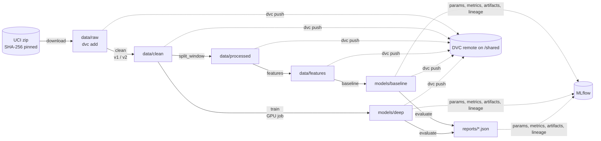

# PAMAP2 activity recognition: a reproducible MLOps pipeline

[](https://github.com/Mrazakos/pamap2-activity-mlops/actions/workflows/ci.yml)
[](https://github.com/Mrazakos/pamap2-activity-mlops/actions/workflows/ci.yml)
[](docs/index.md)

Recognising physical activities from body-worn sensors (three IMUs on wrist, chest and ankle plus
a heart-rate monitor) with a feature-engineered **RandomForest baseline**, a **1D CNN** and a
**CNN-GRU**, built to be exactly reproducible: DVC-versioned data and pipeline, MLflow tracking
with full lineage, deterministic training on a Slurm GPU cluster, tests in pre-commit and CI.

## Why it matters

Smartwatches and fitness bands log what their wearer is doing to estimate energy expenditure and
to give heart rate a context (150 bpm while running is normal, while lying down it is not). The
project also answers a product question: **how much does a wrist-only device lose** compared
with three sensors, and does heart rate help?

## ML task

| | |
|---|---|
| **Task** | multi-class classification of fixed-length windows (default 5.12 s, 50 % overlap) |
| **Input** | synchronised channels: per IMU a ±16 g accelerometer, gyroscope and magnetometer (100 Hz), plus heart rate (~9 Hz, aligned to 100 Hz) |
| **Target** | `activity_id`, mapped to the **12 protocol activities**: lying, sitting, standing, walking, running, cycling, Nordic walking, ascending stairs, descending stairs, vacuum cleaning, ironing, rope jumping |
| **Metrics** | **macro-F1 (primary**, because the classes are imbalanced), accuracy, per-class precision/recall/F1, **per-subject macro-F1** (generalisation to new people), leave-one-subject-out mean ± std |
| **Split** | subject-wise: fixed validation and test subjects, all others train; test is evaluated once |

## Architecture



## Repository layout

```text
configs/params.yaml   single source of truth (data, cleaning, split, windows, models, training); DVC params
src/                  pipeline code (Typer CLI in src/main.py)
  download.py clean.py schemas.py split.py windows.py features.py eda.py data_versions.py
  models/{cnn,cnn_gru,baseline,bundle}.py  train.py  evaluate.py  tracking.py  workflows.py  utils.py
slurm/                job scripts (all source slurm/common.sh)
scripts/              commit guards, MLflow export/backup, results table
tests/                pytest suite (synthetic data only)
docs/                 MkDocs site: data, experiments, results, weaknesses, reproducibility, checklist
dvc.yaml dvc.lock     versioned pipeline
```

## Setup

**Cluster (deep21)**, where all heavy work runs:

```bash
git clone https://github.com/Mrazakos/pamap2-activity-mlops.git /shared/shmqak/projects/pamap2-activity-mlops
cd /shared/shmqak/projects/pamap2-activity-mlops
source /shared/anaconda/anaconda/bin/activate
conda create -n mlops python=3.13 -y && conda activate mlops
pip install -U pip && pip install -r requirements-lock.txt     # exact environment of the tracked runs
pre-commit install
cp .env.example .env                                            # MLflow URI / experiment
dvc pull                                                        # data + models from the DVC remote
```

**Laptop**, for editing, lint and the fast tests (same pins, CPU build of the same torch version):

```bash
python3.13 -m venv .venv && source .venv/bin/activate          # Windows: .venv\Scripts\activate
sed -e 's/+cu126/+cpu/' -e 's#whl/cu126#whl/cpu#' requirements.txt > .venv/requirements-cpu.txt
pip install -U pip && pip install -r .venv/requirements-cpu.txt
pre-commit install && pytest -q
```

## Running on the cluster

Never on the login node: every step is a Slurm job (`--account=mlops_2026_fall`). CPU-only jobs
use no GPU budget; GPU jobs are pinned to `rtx2080ti` so results are bit-identical.

```bash
mkdir -p slurm/logs
sbatch --job-name=download slurm/run_cpu.sh download      # fetch + verify + convert (CPU)
sbatch --job-name=eda      slurm/run_cpu.sh eda           # EDA figures -> MLflow (CPU)
sbatch slurm/repro.sh baseline                            # dvc repro: clean -> ... -> baseline (CPU)
sbatch --gres=gpu:rtx2080ti:1 --job-name=repro-gpu slurm/repro.sh   # + train + evaluate (GPU)
sbatch slurm/train.sh --set train.lr=3e-4                 # one training run with an override
scripts/submit_sweep.sh configs/sweeps/round_a_lr.txt "Round A: learning rate"   # HPO round (job array)
sbatch slurm/verify_repro.sh <run_id>                     # re-run and assert identical results
squeue --me; tail -f slurm/logs/<job>-<id>.out
```

## Reproducing results

* **Whole pipeline:** `dvc pull` restores data and models; `dvc repro` (via `slurm/repro.sh`)
  re-runs whatever changed; `dvc.lock` hashes must stay identical.
* **One MLflow run:** every run has a `reproduce.command` tag
  (`git checkout <commit> && dvc pull && python -m src.main ...`) and a `git.commit`,
  `dvc.data_hash`, `config.hash` and `gpu.name` tag; `verify-repro <run_id>` re-runs it and
  checks metrics and weights hash. Details: [docs/reproducibility.md](docs/reproducibility.md).

## Experiment tracking (MLflow)

* Store, chosen only via `MLFLOW_TRACKING_URI`. Interim: `sqlite:////shared/shmqak/mlflow/mlflow.db`
  with artifacts in `/shared/shmqak/mlflow/artifacts`; experiment `shmqak-pamap2-har`.
* UI: on deep21 `make mlflow-ui`, then on the laptop `ssh -L 5000:127.0.0.1:5000 deep21` and open
  http://localhost:5000 (or run it as a job: `sbatch slurm/mlflow_ui.sh`).
* Grader access: `scripts/export_mlflow.sh` packages database + artifacts into one archive
  (shared privately, never committed); opening it elsewhere is described in
  [docs/reproducibility.md](docs/reproducibility.md).

## Data versioning (DVC)

* Remote: `/shared/shmqak/dvc-remote/pamap2-activity-mlops` (outside the repo, `.dvc/config`).
* `data/raw` is added with `dvc add`; everything after it is a pipeline output.
* Two data versions as git tags: `data-v1` (naive cleaning) and `data-v2` (full quality
  pipeline). Restore one with `git checkout data-v1 && dvc pull`.

## Documentation

MkDocs site in [`docs/`](docs/index.md) (`mkdocs serve`): data and quality issues, experiment
plan, results, weaknesses, reproducibility, environment, the grading checklist and the API
reference.

## Dataset and citation

PAMAP2 Physical Activity Monitoring, UCI Machine Learning Repository (id 231),
https://archive.ics.uci.edu/dataset/231/pamap2+physical+activity+monitoring,
licensed under [CC BY 4.0](https://creativecommons.org/licenses/by/4.0/). No data is stored in
this repository; it is downloaded and verified by `python -m src.main download`.

> A. Reiss and D. Stricker. *Introducing a New Benchmarked Dataset for Activity Monitoring.*
> 16th International Symposium on Wearable Computers (ISWC), 2012.
>
> A. Reiss and D. Stricker. *Creating and Benchmarking a New Dataset for Physical Activity
> Monitoring.* 5th Workshop on Affect and Behaviour Related Assistance (ABRA), 2012.

Code: MIT License (see `LICENSE`).
