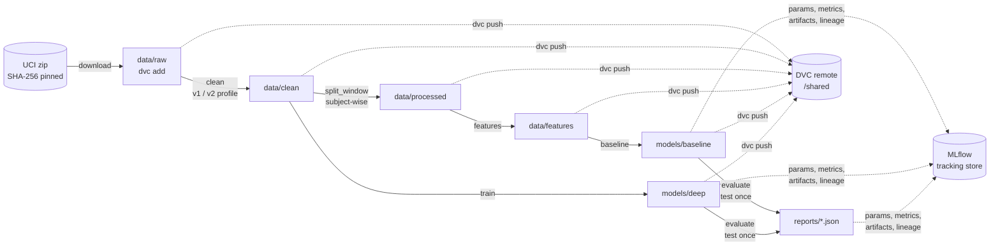

# PAMAP2 activity recognition: a reproducible MLOps pipeline

**Problem.** Consumer health trackers log what their wearer is doing (walking, cycling, climbing
stairs...) to estimate energy expenditure and to put heart rate into context: 150 bpm is normal
while running and alarming while lying down. This project recognises physical activities from
body-worn inertial sensors and a heart-rate monitor, and asks how much a wrist-only
("smartwatch") device loses compared with a three-sensor setup.

| | |
|---|---|
| **ML task** | multi-class classification of fixed-length sensor windows (default 5.12 s, 50 % overlap) |
| **Input** | synchronised channels of 3 IMUs (wrist, chest, ankle: ±16 g accelerometer, gyroscope, magnetometer) + heart rate |
| **Target** | `activity_id`, mapped to the 12 protocol activities (lying, sitting, standing, walking, running, cycling, Nordic walking, ascending/descending stairs, vacuum cleaning, ironing, rope jumping) |
| **Primary metric** | **macro-F1**: classes are imbalanced (rope jumping is ~4x rarer than walking), and every activity matters equally |
| **Other metrics** | accuracy, per-class precision/recall/F1, **per-subject macro-F1** (generalisation to unseen people), leave-one-subject-out mean ± std |
| **Data** | PAMAP2 Physical Activity Monitoring, UCI ML Repository id 231, CC BY 4.0 |
| **Models** | RandomForest on hand-crafted features (baseline), 1D CNN, CNN-GRU |

## Architecture

Every stage runs as a Slurm job on the DeepCluster (CPU-only jobs for everything except
training). See [Reproducibility](reproducibility.md) for the exact commands.
